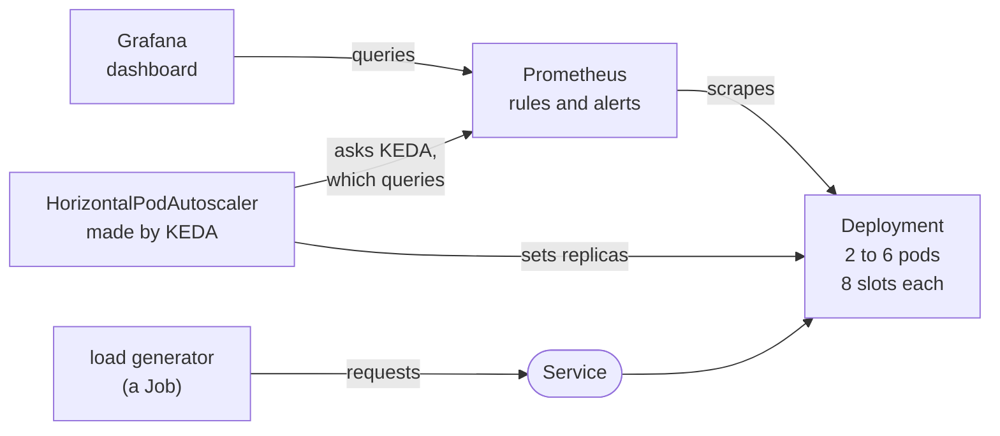

# inference-on-kubernetes

[](https://github.com/shubhroses/inference-on-kubernetes/actions/workflows/e2e.yml?query=branch%3Amain)

An inference-style HTTP API, run on Kubernetes the way a production service is run: a Helm chart, Prometheus error-budget alerts, a Grafana dashboard and KEDA autoscaling on queue depth. The "model" is a stand-in. It holds one of a pod's slots for a configurable time and returns a small JSON result; there is no real model and no GPU here. The subject is everything around the model, and every operational claim in the table below is a test that GitHub Actions runs, on a kind cluster wherever the claim is about a cluster.

## How it fits together



Each arrow points from the one that acts. The load generator stands for the service's clients. KEDA does no scaling of its own here: it makes a HorizontalPodAutoscaler from the chart's ScaledObject, and when that autoscaler asks for its number, every 15 seconds, KEDA answers by running a query against Prometheus. In CI all of this runs in a kind cluster of one control plane and two workers, and the end-to-end tests drive it from outside with kubectl and helm.

## What CI proves

[`ci.yml`](.github/workflows/ci.yml) needs no cluster and takes about a minute. [`e2e.yml`](.github/workflows/e2e.yml) creates the kind cluster on the runner, installs Prometheus, Grafana, KEDA and the chart, and runs the end-to-end tests, once on Kubernetes 1.36 and once on 1.35, in about a quarter of an hour each. Both run on every push to main; `ci.yml` also on every pull request, `e2e.yml` on pull requests that change what reaches the cluster, and every night.

| Claim | Test | Run it |
|---|---|---|
| **Smoke and scrape.** A request through the Service is answered, every pod runs the commit under test, and Prometheus scrapes every pod and sees its request counter follow the requests. | [`e2e/test_1_smoke.py`](e2e/test_1_smoke.py)<br>[`e2e/test_2_scrape.py`](e2e/test_2_scrape.py) | `make e2e` |
| **Dashboard.** Grafana serves the chart's dashboard, and every query on its six panels returns data. | [`e2e/test_3_dashboard.py`](e2e/test_3_dashboard.py) | `make e2e` |
| **Rollout.** A rolling update under 20 requests a second fails none of the 1,800 requests, and never leaves fewer pods Ready than the Deployment asks for. | [`e2e/test_4_rollout.py`](e2e/test_4_rollout.py) | `make e2e` |
| **Node drain.** Draining the node that holds every pod, under the same load, fails none either, and the Ready pods never fall below what the PodDisruptionBudget demands. | [`e2e/test_5_drain.py`](e2e/test_5_drain.py) | `make e2e` |
| **Autoscaling.** Under 24 clients the Deployment goes from 2 pods to 4, by one pod in any 30 seconds at most, and is back at 2 after they stop. No request fails, and the median wait for a slot is shorter at the end of the load than at its start. | [`e2e/test_6_autoscaling.py`](e2e/test_6_autoscaling.py) | `make e2e` |
| **Alerting, the wiring.** Prometheus loads the chart's rules and evaluates each of them without an error. With 30% of the requests failing, the page fires within 3 minutes and clears within 3 minutes of the failures stopping. The windows are shortened for this; the next row has the real ones. | [`e2e/test_7_alerting.py`](e2e/test_7_alerting.py) | `make e2e` |
| **Alerting, the thresholds.** With the windows a real cluster gets: when every request fails, the page fires between minutes 8 and 9; at 20%, between minutes 42 and 44; at 10% never, and the ticket is raised between 3 h 35 min and 3 h 37 min. The page clears within 5 minutes of the failures stopping. A 429 counts like a 5xx. | [`production.test.yaml`](tests/rules/production.test.yaml)<br>in `tests/rules/` | `scripts/test-rules.sh` |
| **The autoscaler's number.** It counts this release's requests, running or waiting, does not count a new pod's requests twice, and is missing, not zero, when Prometheus has no series for the release. | [`autoscaling.test.yaml`](tests/rules/autoscaling.test.yaml)<br>in `tests/rules/` | `scripts/test-rules.sh` |
| **Pod security.** The pods meet the restricted Pod Security Standard. | the install: [the namespace](cluster/namespace.yaml) enforces it | `make up` |
| **Two Kubernetes releases.** The cluster tests pass on 1.36 and on 1.35, and each job checks which release its API server reports. | the matrix of [`e2e.yml`](.github/workflows/e2e.yml) | `make up`<br>`make e2e`<br>on [each](#run-it-locally) |
| **Cluster safety.** `make` and the tests refuse to act on any cluster but the kind cluster this repository created. | [`test-cluster-guard.sh`](scripts/test-cluster-guard.sh)<br>in `scripts/` | the script |
| **The service.** A pod serves as many requests at once as it has slots, lets a bounded number wait, in arrival order, and answers any more with 429 at once. `/readyz` says no while the model loads and while the pod drains, and yes when every slot is busy. The `fail` and `delay` parameters do nothing unless the test flag is set. | [`tests/test_slots.py`](tests/test_slots.py)<br>[`tests/test_api.py`](tests/test_api.py) | `make test` |
| **Shutdown.** On SIGTERM the service stops listening, still answers on the connections that are open and tells them to close, finishes the requests it holds, running or queued, and exits with status 0. | [`tests/test_server.py`](tests/test_server.py) | `make test` |
| **Names line up.** The dashboard, the rules and the autoscaler ask only for series that the service exports or the rules record, and the dashboard draws the objective and the burn rates that `values.yaml` sets. | [`tests/test_dashboard.py`](tests/test_dashboard.py)<br>[`tests/test_rules.py`](tests/test_rules.py)<br>[`tests/test_autoscaling.py`](tests/test_autoscaling.py) | `make test` |
| **The load generator.** Its clients do what the client model below says: connections are reused, no request is sent twice, and anything but a 200 is a failure. | [`tests/test_loadgen.py`](tests/test_loadgen.py) | `make test` |
| **The image.** It runs as a non-root user on a read-only root filesystem without capabilities, serves requests, reports the commit it was built from, and exits with status 0 on SIGTERM. | [`scripts/test-image.sh`](scripts/test-image.sh) | `make image`<br>the script |
| **Supply chain.** The image has no High or Critical vulnerability for which a fix has been published. Every action is pinned to a commit, and every image in `versions.env` to a digest. The rendered chart is valid against the Kubernetes API schemas. | Trivy, pin checks, kubeconform | the steps of [`ci.yml`](.github/workflows/ci.yml) |

`make e2e` needs the cluster that `make up` creates. Every `e2e` run writes what it measured to its summary page: the requests and failures of each load, latency percentiles, the replica counts the autoscaler went through, and when the alert fired and cleared. It keeps the load reports, the cluster's events and the pod logs as an artifact. These numbers are from [a run on main](https://github.com/shubhroses/inference-on-kubernetes/actions/runs/38070586384), on a GitHub-hosted runner with 2 CPUs; the stand-in's model time is 100 ms.

| Test | Requests | Failed | p50 | p95 | p99 | max |
|---|---|---|---|---|---|---|
| Rollout | 1800 | 0 | 103 ms | 105 ms | 107 ms | 194 ms |
| Drain | 1800 | 0 | 103 ms | 104 ms | 106 ms | 114 ms |
| Autoscaling | 37079 | 0 | 104 ms | 189 ms | 226 ms | 302 ms |

In that run the autoscaler asked for a third pod 37 s after the load was started and for a fourth 30 s later, and was back at 2 pods 75 s after the load ended. The page was firing 38 s after the failing requests were started and was gone 19 s after they stopped.

## What happens when a pod is told to go

A rolling update, a node drain and a scale-down all take a pod away in the same way, and the chart gives it 30 seconds (`termination` in [`chart/values.yaml`](chart/values.yaml)):

| When | What happens |
|---|---|
| 0 s | The pod is deleted or evicted. Its endpoint is marked as terminating, and each node stops routing new connections to it as soon as it hears of that. The kubelet runs the preStop hook, which sleeps for 10 s. The service has been told nothing and serves as before. |
| 10 s | SIGTERM. The service stops listening, answers `/readyz` with 503 and puts `Connection: close` on every response. |
| 10 to 15 s | The lame duck, one keep-alive timeout long. Connections that are open stay open. One that carries a request gets its answer and, with it, the word to close. One that carries nothing reaches the idle timeout of 5 s, as it would on any other day. |
| 15 s | uvicorn's own shutdown: requests that are still running or queued are answered, for which there are 15 s more, and the process exits with status 0. |
| 30 s | The grace period ends. The kubelet would now kill what is left. |

There are two delays because they protect different clients. The preStop delay is for clients that open a new connection: without it they are routed, for a moment, to a pod that no longer listens. The lame duck is for clients that already have a connection: no change to the Service reaches them, so only the server can send them away, and it can only do that politely in a response. Each delay was removed once in CI while this was built. Without the preStop delay the rollout test failed, with 9 of 1,800 requests refused; without the lame duck the drain test failed, with 6 of 1,800 requests closed without an answer on a kept connection.

The lame duck is as long as the keep-alive timeout, and the two are one setting. The server closes any connection that has been idle for 5 s anyway, so a client may never count on one that old. After a lame duck of the same length every connection has either carried a request, and been told to close, or been idle for the whole 5 s. The drain closes nothing that the server would not also close on a normal day.

Readiness and liveness are different probes on different paths. `/readyz` decides whether the pod is sent requests: no while the model loads and while the pod drains, yes when every slot is busy, because a full pod answers 429 by itself and taking it out of the Service would only move its load onto the others. `/healthz` decides whether the container is restarted, and answers as long as the event loop is turning, so a pod is never restarted for being busy, loading or draining.

### The clients the zero-failure claim is about

"No request failed" is a statement about clients, so the load generator spells out what its clients do ([`loadgen/load.py`](loadgen/load.py)):

- Requests are due at fixed times, 20 a second for 90 seconds, whether or not the earlier ones have been answered. Latency counts from the moment a request was due.
- Half of them go over eight connections that are kept open (HTTP/1.1 keep-alive). When a response says `Connection: close`, the client opens a new connection for its next request. It does not use a connection that has been idle for more than 2 s, which has to be less than the server's 5 s.
- The other half each open a connection, send one request and disconnect.
- No request is sent twice, and no client checks whether a connection is still open before it uses it. Many real clients do one or the other, so this is the stricter case.
- A request has failed unless it is answered with 200 within 10 s: refused, reset, closed without an answer, cut short, timed out, or answered with any other status, 429 and 503 included.
- The Service's name is resolved once. Every connection then goes to the Service's cluster IP, and kube-proxy picks the pod. The load generator runs as a Job on the control-plane node, the one node the tests never drain.

## Design decisions

**Scale on the requests a pod holds, not on its CPU.** The autoscaler's number is the requests running in a slot plus those waiting for one, per pod, with a target of 6 against 8 slots. The alternative is the usual CPU target. But a request holds a slot for as long as the model takes, and the pod's own CPU is close to idle meanwhile: the stand-in sleeps, and a real model would be busy on a GPU. Measured on a laptop with all eight slots busy: about a tenth of a core. CPU cannot tell a full pod from an empty one; the number of requests it holds can. The target is below the slot count so that pods are added before requests have to wait.

**Add at most one pod every 30 seconds.** The alternative is the HorizontalPodAutoscaler's default, which may double the pods, or add four, every 15 seconds. A queue says that there are too few pods; it does not say how many are missing. When requests arrive only a little faster than the pods serve them, the queues fill to the brim all the same (8 running and 16 waiting is four times the target), and the number asks for the maximum. So pods are added one at a time, and each has half a minute to start, load its model and take its share before the next is decided on. With the limit loosened in CI while this was built, the same 24 clients took the Deployment from 2 pods to 4 in two steps 15 s apart, or in one step, and the test failed on it; with the limit, the two steps have been 30 s apart in every run.

**A 429 spends the error budget.** The alternative is to count only 5xx, on the grounds that a service that sheds load is working as designed. But a shed request is one a client did not get served. If rejections were free, the service could meet any objective by rejecting everything, and running out of capacity would never page anyone. Counted, saturation spends the budget, and the alert on a queue at maximum replicas is the earlier and cheaper warning.

**Load comes from inside the cluster.** The alternative is `kubectl port-forward` from the runner, which is less work. But a port-forward is a tunnel to one pod: it goes around the Service, and a test of what happens to clients while pods are replaced would test nothing. The load generator runs as a Job in the service's own image, and each of its connections is routed by the cluster, as a real client's is.

Smaller ones, each explained where it is made:

- The autoscaler's number is added up over the pods at each scrape and then averaged over a window. A scrape reads every pod at a different instant, so a single sum can be several requests off, which is enough to add a pod that nothing needed ([`chart/templates/scaledobject.yaml`](chart/templates/scaledobject.yaml)).
- If Prometheus has no series for the release, the autoscaler gets an error and the replica count stays where it is. KEDA's default reads no answer as zero, and would take a busy Deployment down to its minimum.
- The Deployment has no `replicas`: the field belongs to the autoscaler, and a `helm upgrade` must not put it back ([`chart/templates/deployment.yaml`](chart/templates/deployment.yaml)).
- The window of each recorded error ratio is a label, not part of the series' name, so the same dashboard draws the real windows and the test cluster's short ones ([`chart/templates/prometheusrule.yaml`](chart/templates/prometheusrule.yaml)).
- Prometheus, Grafana, KEDA and the load generator run on the control-plane node, because the tests drain the workers.
- Images from Docker Hub are pulled through Google's mirror, by digest. Docker Hub's limit on anonymous pulls failed CI once, through no fault of the commit ([`versions.env`](versions.env)).

## The alerts, and which test proves what

The objective is that 99% of the requests are answered successfully, so the error budget is 1%. [`chart/templates/prometheusrule.yaml`](chart/templates/prometheusrule.yaml) records the error ratio over four windows and has four alerts:

| Alert | Fires while | Severity |
|---|---|---|
| `InferenceErrorBudgetFastBurn` | the error ratio is above 14.4 x 1% over the last hour and over the last 5 minutes | page |
| `InferenceErrorBudgetSlowBurn` | the error ratio is above 6 x 1% over the last 6 hours and over the last 30 minutes | ticket |
| `InferenceLatencyHigh` | for 5 minutes, more than one successful request in twenty has taken longer than 0.5 s | ticket |
| `InferenceQueueAtMaxReplicas` | for 5 minutes, requests have been waiting for a slot while the Deployment is at its maximum of 6 replicas | ticket |

The long window makes sure that a real share of the budget is gone, and the short one that it is still being spent, so an alert clears soon after the failures stop. What an alert costs before it fires is its burn rate times its long window: 14.4 x 1 h is 2% of a 30-day budget for the page, and 6 x 6 h is 5% for the ticket.

When they fire follows from arithmetic. If a share e of the requests fails from some moment on, a window of length W has an error ratio of e x t / W after a time t, which passes a threshold of B x 1% at t = B x 1% x W / e:

- every request fails: the page after 14.4% x 60 min / 100% = 8.64 min;
- 20% fail: the page after 14.4% x 60 min / 20% = 43.2 min;
- 10% fail: never the page, since 10% is below 14.4%; the ticket after 6% x 360 min / 10% = 3 h 36 min;
- the failures stop: the 5-minute window is back under 14.4% within 5 min x (1 - 14.4%) = 4.28 min.

Two kinds of test stand behind this, and they prove different things:

- **The thresholds: `promtool`, without a cluster.** [`scripts/test-rules.sh`](scripts/test-rules.sh) renders the chart with its default values and has `promtool test rules` evaluate the rules over made-up series ([`tests/rules/production.test.yaml`](tests/rules/production.test.yaml), where the derivation is written out). Those series have one sample a minute, so each test brackets its figure between two whole minutes: for 8.64, silent at minute 8 and firing at minute 9.
- **The wiring: the end-to-end test, with shortened windows.** A test cannot wait an hour for a page, so [`values-kind.yaml`](chart/values-kind.yaml) gives the page windows of 2 minutes and 30 seconds, and leaves the thresholds alone. [`e2e/test_7_alerting.py`](e2e/test_7_alerting.py) then shows what `promtool` cannot: that the chart's PrometheusRule reaches Prometheus, that Prometheus evaluates every rule without an error, that it is the release whose `promtool` checked them, and that the page follows what real requests do. It says nothing about when a real cluster would page.

The autoscaler is split the same way. `promtool` evaluates its query as rendered with the default values. The end-to-end test runs it on a cluster where the pods are scraped every 2 s, the number is averaged over 45 s and scaling down waits 60 s; the defaults are 15 s, 1 min and 5 min.

## The same signals on a GPU model server (not tested here)

Nothing in this section is tested in this repository: it has no GPU and no real model. It is how the pieces would map, and what would have to be measured again.

- **Slots.** A replica serves a bounded number of requests at once, set by what fits in the GPU's memory. The bounded queue and the 429 beyond it stay as they are.
- **The autoscaler's number.** Model servers export the same two gauges, requests running and requests waiting; vLLM, for one, has `vllm:num_requests_running` and `vllm:num_requests_waiting`. The ScaledObject's query changes its metric names and keeps its shape. CPU says even less there than here, because the work is on the GPU.
- **Model load.** Two seconds become minutes, and a new replica may first need a new node. The startup probe's budget, the scale-up period and the scale-down window have to grow with it: a pod that is expensive to bring up should neither be added before the last one has taken its share nor be removed in a lull.
- **Draining.** A streamed answer outlasts the 15 s that `termination.requestSeconds` allows a request, so that setting follows the longest generation. The two delays work as before.
- **The objective.** The error budget and the burn-rate arithmetic do not change. The latency alert would be about the time to the first token, or the time per token, and not about the whole request.
- **What does not carry over.** Every number here: the latencies, the thresholds, the timings. And the signals a GPU adds, such as its memory and its utilization.

## Limitations

- The model is a stand-in. The latencies above measure the service, the cluster's network and a GitHub-hosted runner, not inference.
- Everything that needs a cluster has run only in GitHub Actions, on `ubuntu-24.04` runners with amd64 CPUs, against a kind cluster whose three nodes are containers on one machine. News of a terminating pod reached every node there in under a second; the preStop delay of 10 s is ten times that, and nothing measures how long it takes on a large cluster.
- The zero-failure claim holds for the client model above. A client that reuses a connection which has been idle for 5 s or longer can lose a request at any time, drain or no drain. HTTP/2 is not served. A request that is still running 20 s after its pod's SIGTERM is cut off. A request whose client has gone away keeps its slot until the model returns.
- Nothing keeps the pods on different nodes: there is no topology spread constraint. A PodDisruptionBudget does not help when a node fails without warning, and no test covers that, or a pod that a scale-down removes while requests arrive.
- There is no Alertmanager. An alert is a state in Prometheus, which the tests read; nobody is told.
- The burn-rate alerts are silent when there is no traffic, and jumpy when there is very little: one failed request in a quiet five minutes is an error ratio of 100%. No alert says that the service has disappeared from Prometheus.
- The latency alert and the alert on a queue at maximum replicas are tested by `promtool` only. Nothing in the cluster drives the Deployment to 6 replicas.
- The autoscaler runs on the test cluster with a faster scrape and shorter windows than the defaults. With the defaults its number is the average of four readings a minute, each of which can be several requests off, so a steady load near a boundary will now and then get one pod more than the arithmetic says. Clients that keep their connections stay with the pods they first reached; adding pods does nothing for them until they reconnect.
- The chart takes its surroundings for granted: the CRDs of the Prometheus Operator and of KEDA, a Grafana sidecar that looks for the label `grafana_dashboard`, a Prometheus data source with the UID `prometheus`, and a Prometheus at `autoscaling.prometheusAddress`. It has no switches for a cluster without them. The dashboard's threshold lines are those of the default values.
- No image is published. `make up` builds it and copies it onto the kind nodes.
- The images that the kube-prometheus-stack and KEDA charts run are named by tag inside those charts; the charts themselves are pinned, by digest and by checksum. Trivy's database is not pinned, so the same commit can pass today and fail later. Nothing updates the pins automatically.

## Run it locally

The Makefile's targets are what CI runs. They need Docker, kind, kubectl, Helm and Python 3.13; CI installs kind 0.33.0, kubectl 1.36.4 and Helm 4.3.0 ([`versions.env`](versions.env)).

```sh
python3.13 -m venv .venv && . .venv/bin/activate
pip install --require-hashes -r requirements-dev.txt

make test                # unit tests, with a coverage floor of 95% on app/
scripts/test-rules.sh    # promtool on the rendered rules; needs helm and docker

make up                  # kind cluster, Prometheus, Grafana, KEDA, the image, the chart
make e2e                 # the end-to-end tests, in order; stops at the first failure
python -m e2e.summary    # what they measured, as CI's job summary shows it
make down                # delete the cluster
```

On the runners the numbers above come from, with 2 CPUs and 8 GB of memory, `make up` took about three and a half minutes and `make e2e` about ten, and a little over 3 GB of memory were in use when the tests ended. For the cluster on the other Kubernetes release, `make down` first, then:

```sh
. ./versions.env && make up KIND_NODE_IMAGE="$KIND_PREVIOUS_NODE_IMAGE"
```

The cluster's kubeconfig is `.kube/config` inside the repository, and the Makefile reads no other: it sets `KUBECONFIG` itself and stops unless the current context is `kind-inference-on-kubernetes`, and the tests check the same before they start. To look around with your own kubectl, and to see the dashboard:

```sh
export KUBECONFIG=$PWD/.kube/config
kubectl --namespace inference get pods,horizontalpodautoscalers
kubectl --namespace monitoring port-forward service/kube-prometheus-stack-grafana 3000:80
# then http://localhost:3000/d/inference, no login
```

The image checks of `ci.yml`, by hand:

```sh
make image
scripts/test-image.sh "inference-on-kubernetes:$(git rev-parse HEAD)" "$(git rev-parse HEAD)"
```

To watch a test catch a regression, break the chart and run the suite again. Set `termination.preStopSeconds` to 0 in `chart/values.yaml`, and the rollout test reports refused connections; set `autoscaling.scaleUp.pods` to 4 and `periodSeconds` to 15, and the autoscaling test reports a rise of more than one pod within 30 s. `make up` applies the change to the running cluster, and `make e2e` runs the tests.

Where things are:

| Path | What is in it |
|---|---|
| [`app/`](app) | The service: FastAPI, a semaphore of model slots, a bounded queue, 429 beyond it, Prometheus metrics, a drain on SIGTERM. |
| [`chart/`](chart) | The Helm chart: Deployment, Service, PodDisruptionBudget, ServiceMonitor, PrometheusRule, Grafana dashboard, KEDA ScaledObject. [`values.yaml`](chart/values.yaml) gives the reason for each default; [`values-kind.yaml`](chart/values-kind.yaml) is what the test cluster changes. |
| [`cluster/`](cluster) | The kind cluster, the namespace, and the values for a trimmed kube-prometheus-stack and for KEDA. |
| [`loadgen/`](loadgen) | The load generator: an asyncio client on the standard library, run as a Job inside the cluster. |
| [`tests/`](tests) | Unit tests of the service and the load generator, and `promtool` tests of the alert rules and the autoscaler's query in [`tests/rules/`](tests/rules). |
| [`e2e/`](e2e) | The end-to-end tests, which drive `kubectl`, `helm` and the HTTP APIs of Prometheus and Grafana. |
| [`Makefile`](Makefile), [`scripts/`](scripts) | `make up`, `make test`, `make e2e` and `make down`, the same on a laptop and in CI, and the checks that are shell scripts. |
| [`versions.env`](versions.env) | The pinned tools, images and charts, in one place. |

## Licence

[MIT](LICENSE).
